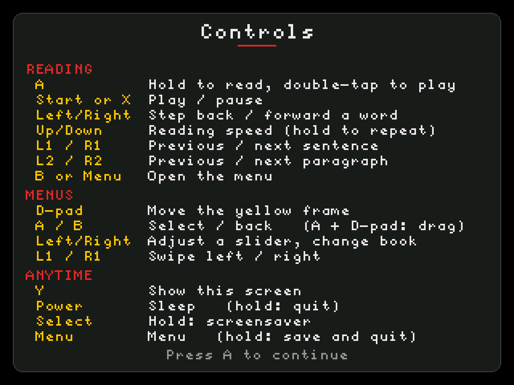

# RSVP Nano for NextUI (TrimUI Brick)

This port runs the RSVP Nano firmware on Linux handhelds with
[NextUI](https://github.com/LoveRetro/NextUI), starting with the TrimUI Brick (`tg5040`). The
reader, library, EPUB/PDF conversion, settings and focus timers are the firmware's own code. A
small Linux layer stands in for the ESP32, and an SDL2 host handles the screen and the buttons.

## Install

1. Download `RSVP.Nano.pak.zip` from the GitHub Actions run (or build it, see below).
2. Unzip it at the root of the SD card. You should get `Tools/tg5040/RSVP Nano.pak/launch.sh`.
3. Put books in `RSVP Nano/library/` at the root of the SD card: `.epub`, `.pdf`, `.txt`,
   `.md`, `.html` or `.rsvp`. That folder is created the first time you launch the pak. EPUBs and
   PDFs are converted the first time you open them.
4. Open **Tools → RSVP Nano**.

You can also send books over Wi-Fi, see below.

Reading positions and preferences are stored in `.userdata/tg5040/RSVP Nano/`. The log is in
NextUI's logs folder (`RSVP Nano.txt`).

## Controls

The firmware was designed for a touchscreen. The pak drives that touch UI from the buttons.
A controls screen appears the first time you launch the pak; press **Y** at any time to see it
again.



| Button | Reader | Menus |
| --- | --- | --- |
| **D-pad** | ←/→ scrub words · ↑/↓ change speed, repeats while held (page preview: browse paragraphs) | Move the focus (yellow frame) |
| **A** | Press like a finger: hold to read while held, double-tap to play | Activate the focused item |
| **A + D-pad** | Drag | Drag (sliders, the library shelf) |
| **←/→ on a slider, stepper or shelf** | | Change the value / select the previous or next book |
| **Start** (play/pause key) | Play / pause | |
| **X** | Play / pause | |
| **B** | Back to the menu | Back |
| **L1 / R1** | Previous / next sentence (keeps playing) | Swipe left / right |
| **L2 / R2** | Previous / next paragraph (keeps playing) | Swipe down / up |
| **Y** | Show the controls screen | Show the controls screen |
| **Select (hold)** | Screensaver | Screensaver |
| **Power** | Sleep (hold: quit) | Sleep (hold: quit) |
| **Menu** (TrimUI key) | Open the menu (hold: save and quit to NextUI) | Back to the reader (hold: save and quit) |

A and B follow NextUI's layout (A confirms, B goes back). If they are swapped on your device,
add `export RSVP_SWAP_AB=1` near the top of `launch.sh`.

## Sleep, focus timers, rumble, sound and LEDs

- **Power** turns the screen off at once and saves your place. After NextUI's suspend timeout
  (NextUI settings) the Brick suspends with NextUI's own suspend script; press Power to wake up.
  While charging it stays in screen-off sleep, as NextUI does. Holding Power quits to NextUI.
- **Focus timers** work without the motion sensor: open a timer, then press **A** on the
  hourglass to start, pause or resume a phase (where other readers are turned over).
- When a focus or break phase ends, the Brick **chimes** (system volume), **rumbles** three
  times and **blinks** its LEDs.
- **LEDs**: while a book plays, the top bar shows how far you are (red at the start, amber half
  way, green at the end). During a focus session it breathes red (focus) or blue (break). Otherwise,
  and when you quit or sleep, NextUI's own LED settings apply. LED brightness stays NextUI's setting
  (LedControl), so LEDs set to brightness 0 stay off.
- Rumble on sleep and wake follows NextUI's haptics setting.
- To turn a channel off, add `export RSVP_RUMBLE=0`, `RSVP_SOUND=0` or `RSVP_LEDS=0` to `launch.sh`.

## Sending books over Wi-Fi

1. Turn on Wi-Fi in NextUI's settings and connect the Brick to your network.
2. In RSVP Nano, open the menu → **Device → Companion sync**. The screen shows an address such as
   `http://192.168.1.23`.
3. Scan the QR code on that screen, or open the address in a browser on a phone or computer on
   the same network. Choose or drop
   books (EPUB, PDF, RSVP, TXT, Markdown, HTML); the page also lists and deletes the books on the
   Brick. EPUBs and PDFs are converted on the Brick the first time you open them.
4. Press **B** on the Brick to close Sync. The server only runs while that screen is open.

The [web companion](https://ionutdecebal.github.io/rsvpnano/) can also connect to that address
(desktop Chrome or Edge; allow local network access when asked). It manages themes, fonts and
settings too, but converts EPUBs in the browser first.

## Not available on the Brick

USB mass storage, OTA updates, USB (serial) companion and RSS sync have no NextUI equivalent yet.
Their buttons are left out of the Device tab. Wi-Fi is set up in NextUI, not in RSVP Nano:
**Settings → Network & updates** only shows the connection NextUI made. To update, install a newer
pak. Screen brightness stays under NextUI's own control (Menu + volume).

## Build

```sh
# Desktop build for development (needs cmake, a C++23 compiler and libsdl2-dev)
ports/nextui/build.sh desktop
build/nextui-desktop/rsvpnano --data ./sdcard        # arrows, Z/Enter = A, X/Esc = B, Space = X, Tab = Start

# TrimUI Brick pak (needs cmake, zip and Zig: `pip install ziglang`)
ports/nextui/build.sh pak                            # -> dist/RSVP.Nano.pak.zip
```

The firmware is C++23, which the stock tg5040 GCC 8.3 cannot compile. The pak is therefore built
with Zig's clang and libc++, targeting the Brick's glibc 2.23. It links only against the device's
own `libSDL2-2.0.so.0`, whose headers come from the TrimUI SDK (downloaded once into
`.nextui-cache/`).

`--script` runs the app unattended, which is useful for CI and screenshots:

```sh
SDL_VIDEODRIVER=dummy build/nextui-desktop/rsvpnano --data ./sdcard \
  --script "wait 1500; press start; wait 500; shot menu.bmp; press a; wait 1000; quit"
```

## How it fits together

| Path | Role |
| --- | --- |
| `src/platforms/nextui/` | `Board::*` implementation, SDL2 host (`NextUiHost.cpp`), button-to-touch navigator |
| `ports/nextui/shim/` | Arduino / ESP-IDF / FreeRTOS headers for Linux |
| `ports/nextui/runtime/` | Their implementation: POSIX files for `fs::FS`, pthreads for tasks and queues, file-backed `Preferences` |
| `ports/nextui/stubs/` | USB, OTA, Wi-Fi companion and RSS stand-ins that report "not available" |
| `ports/nextui/CMakeLists.txt` | Builds `src/` unchanged, plus the vendored zlib, HarfBuzz, SheenBidi and PDFio |

There are three small changes to shared UI code, and none of them affects the ESP32 builds:

* `ui::Context::forEachTarget()` / `setFrameObserver()` publish the widgets of each frame, so a
  host without a touchscreen can move a focus between them. `navigationTarget()` lets custom
  gesture widgets (the library shelf) take part.
* `screens::detail::wideLayout()` replaces the hard-coded `height <= 240` checks. Boards with
  taller landscape screens can then use the tabbed layout (`RSVP_WIDE_LAYOUT_MAX_HEIGHT`).
